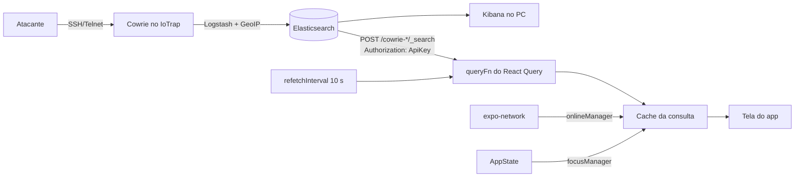

# Diário de pesquisa

## Contexto do TCC

O IoTrap é um honeypot de alta interação para dispositivos IoT. Ele simula serviços
vulneráveis (Cowrie para SSH/Telnet, Dionaea para malware), coleta IPs, credenciais,
comandos e indicadores de comprometimento, enriquece os dados com VirusTotal e GeoIP,
bloqueia endereços com iptables e mostra tudo no Elastic/Kibana, com uma Raspberry Pi
no monitoramento e nos alertas. O público é a pequena e média empresa, que não tem
uma equipe olhando o Kibana o dia inteiro.

## Pergunta de pesquisa

Como o `@tanstack/react-query` permite que um app Expo mostre, quase em tempo real, os
ataques que o IoTrap grava no Elasticsearch, **mantendo a última lista na tela e
avisando o motivo quando o celular fica sem rede ou a API do IoTrap sai do ar**?

Restrição real: quem acompanha o honeypot nem sempre está no computador. No celular a
rede cai, o app vai para segundo plano, e o servidor do honeypot (VM ou Raspberry Pi)
também pode cair. O Kibana no navegador do celular é pesado e não avisa nada disso.

## Alternativas consideradas

Todas as opções abaixo são JavaScript puro ou módulos incluídos no Expo Go, então
nenhuma exige development build.

| Opção | Serve para | Funciona no Expo Go | Decisão |
|-------|-----------|---------------------|---------|
| `fetch` + `useEffect` | Buscar uma vez ao montar a tela | sim (nativo) | não: polling, cancelamento, novas tentativas, cache e pausa sem rede teriam de ser escritos à mão |
| Hook próprio `useFetch` | Reaproveitar o `fetch` + `useEffect` | sim | não: é o mesmo trabalho, só organizado num hook; útil como comparação na apresentação |
| `@tanstack/react-query` v5 | Cache de dados do servidor com `refetchInterval`, `retry`, `onlineManager` e `focusManager` | sim (JS puro) | **sim**: cada critério vira uma opção da biblioteca, sem estado manual |
| Kibana no navegador do celular | Ver os dashboards que o TCC já tem | não se aplica | não: interface de desktop, sem aviso de rede e sem estado offline |
| `@react-native-community/netinfo` | Estado da rede para o `onlineManager` | sim (docs da Expo: "Included in Expo Go") | não: funciona, mas preferi o módulo da própria Expo |
| `expo-network` | Estado da rede para o `onlineManager` | sim (docs da Expo: "Included in Expo Go") | **sim**: módulo da Expo, recomendado pelo AGENTS.md do template, e a doc do TanStack tem exemplo com ele |

SWR e RTK Query também resolvem o problema, mas não estão na Tabela 1 da disciplina e
não conferi a documentação deles; ficaram de fora.

## Como funciona

- A cada 10 s, com o app em primeiro plano, o React Query chama a `queryFn`, que faz
  `POST /<índice>/_search` pedindo os 50 eventos mais novos das últimas 24 h.
- O resultado fica em cache. Se a próxima busca falhar, a tela continua com o cache e
  mostra o motivo; `isRefetchError` diferencia "falhou, mas tenho dados" de "nunca
  carreguei".
- Falhas temporárias (rede, tempo esgotado, 5xx) ganham mais duas tentativas.
  Falhas de configuração (401, 403, 404) não: tentar de novo não muda a chave errada,
  e o polling também para até o usuário tocar em "Tentar de novo".
- No React Native não existe `window`, então o React Query não sabe sozinho se há rede
  ou se o app está aberto. `expo-network` alimenta o `onlineManager` (sem rede, as
  buscas ficam pausadas e voltam sozinhas quando a rede volta) e o `AppState` alimenta o
  `focusManager` (em segundo plano não há polling; ao voltar, busca na hora).

## Fontes oficiais lidas

Abrir cada link antes de usar na apresentação.

- TanStack Query, React Native (onlineManager, focusManager): https://tanstack.com/query/latest/docs/framework/react/react-native
- Expo, Network (`expo-network`): https://docs.expo.dev/versions/latest/sdk/network/
- Expo, `@react-native-community/netinfo`: https://docs.expo.dev/versions/latest/sdk/netinfo/
- Expo, Environment variables (`EXPO_PUBLIC_`): https://docs.expo.dev/guides/environment-variables/
- Expo, Using Model Context Protocol (MCP) with Expo: https://docs.expo.dev/eas/ai/mcp/
- Expo Changelog, "The Expo MCP Server is now available on the Free plan" (26 mai. 2026): https://expo.dev/changelog/the-expo-mcp-server-is-now-available-on-the-free-plan
- Elastic, Elasticsearch API conventions (cabeçalho `Authorization: ApiKey`): https://www.elastic.co/docs/current/serverless/elasticsearch/api-conventions
- Elastic, Search API (`size`, `from`, `sort`, limite de 10.000 resultados): https://www.elastic.co/guide/en/elasticsearch/reference/8.17/search-search.html
- Elastic, Create an API key (`POST /_security/api_key`, `role_descriptors`, campo `encoded`): https://www.elastic.co/guide/en/elasticsearch/reference/8.17/security-api-create-api-key.html
- Cowrie, Output Event Code Reference (`cowrie.login.failed`, `cowrie.command.input`...): https://docs.cowrie.org/en/latest/OUTPUT.html

## Mapa do tema: onde as IAs divergem (exercício 3)

Mesmo prompt da seção 4.2 da apostila nas duas ferramentas.

- **Claude:** indicou `@tanstack/react-query` com `onlineManager`/`focusManager`, e
  `expo-network` ou NetInfo para a rede; as duas bibliotecas de rede constam como
  "Included in Expo Go" na documentação da Expo.
- **[segunda ferramenta: ChatGPT, Gemini ou Copilot]:** [preencher]
- **Onde divergem e qual a documentação confirma:** [preencher]

## Onde a IA errou

### 1. MCP do Expo: grátis ou pago?
- **Pedido:** ler a página oficial do MCP da Expo e dizer o que é preciso para usar.
- **O que veio:** a IA (Claude, resumindo a página) respondeu que o servidor exige plano
  pago do EAS e "não é gratuito".
- **Como percebi:** a apostila diz que basta uma conta Expo gratuita. Fui atrás e achei
  o changelog oficial da Expo de 26/05/2026 anunciando que o MCP passou a estar no plano
  Free, com uma cota mensal de uso.
- **O certo:** a frase da página de documentação ficou desatualizada; o changelog
  oficial anuncia uso gratuito com cota. A IA repetiu fielmente uma fonte velha. A
  confirmação final é conectar com a conta gratuita (Passo 2 da seção 5.2).

### 2. Mock declarado depois do import nos testes
- **Pedido:** escrever testes do `App.tsx` simulando rede e servidor.
- **O que veio:** o mock do `expo-network` usava um array declarado no topo do arquivo,
  mas o `import App` é içado pelo Babel e roda antes. A suíte quebrou com
  `Cannot read properties of undefined (reading 'push')`.
- **Como percebi:** erro ao rodar `npx jest`.
- **O certo:** criar o array dentro do `jest.mock(...)`, ler com `jest.requireMock` e
  carregar o `App` com `require` depois dos mocks.

### 3. `null` em `ListHeaderComponent`
- **Pedido:** mostrar a faixa de aviso no topo da `FlatList` só quando houver problema.
- **O que veio:** `ListHeaderComponent={condição ? <Faixa/> : null}`.
- **Como percebi:** `npx tsc --noEmit` falhou: nos tipos do React Native 0.88 a prop
  aceita elemento, componente ou `undefined`, mas não `null`.
- **O certo:** usar `undefined` no lugar de `null`.

### 4. `as const` deixou a configuração rígida demais
- **Pedido:** um objeto de configuração da API que os testes pudessem sobrescrever.
- **O que veio:** `IOTRAP_CONFIG = {...} as const`, que faz o TypeScript tratar
  `timeoutMs` como o literal `8000`, e não como `number`.
- **Como percebi:** o app compilava, mas o `tsc` falhou quando os testes passaram um
  `timeoutMs` diferente.
- **O certo:** declarar uma interface `IoTrapConfig` com `timeoutMs: number` e tipar o
  objeto com ela.

### 5. [erro encontrado com o Copilot no modo Agent]
- **Pedido:** [preencher]
- **O que veio:** [preencher]
- **Como percebi:** [erro de compilação, documentação, teste no aparelho]
- **O certo:** [o que a documentação confirma]

## Resultado e próximos passos no TCC

**O que a prova de conceito demonstrou** (conferir no aparelho e marcar no CRITERIOS.md):

- 16 testes automatizados passam (`npm test`). Os testes do `App` simulam os critérios
  C1 a C6 com servidor falso, rede e AppState controlados, e falham quando
  `onlineManager`, `focusManager` ou a parada do polling no 401 são removidos.
- O adaptador da API foi testado contra o `mock-server` real: lista ordenada, ataque
  novo no topo, 503, 401, 404, porta fechada, tempo esgotado e cancelamento.
- `npx expo export --platform android` gera o bundle sem erro, com a URL do `.env.local`
  embutida.
- Verificação no celular: [preencher depois de rodar no Expo Go]

**O que muda no TCC:**

- O app não deve falar direto com o Elasticsearch em produção. Tudo que começa com
  `EXPO_PUBLIC_` vai embutido no aplicativo, então a chave fica exposta. Na PoC uso uma
  chave somente leitura, restrita ao índice do Cowrie; no TCC o caminho é uma API de
  leitura do próprio IoTrap na frente do Elasticsearch.
- Alertas de eventos graves (login aceito, download de malware) com notificação.
- Guardar o cache entre aberturas do app, para abrir já com a última lista mesmo sem rede.
- Incluir os eventos do Dionaea e mostrar se o IP já foi bloqueado pelo iptables.
